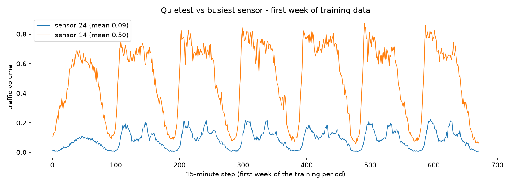
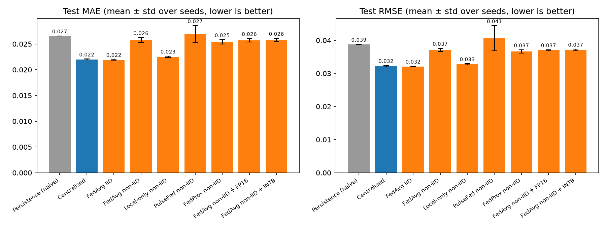
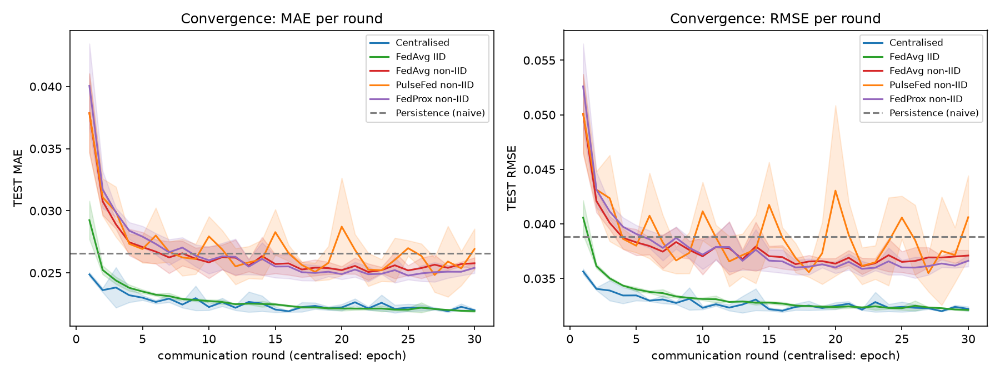
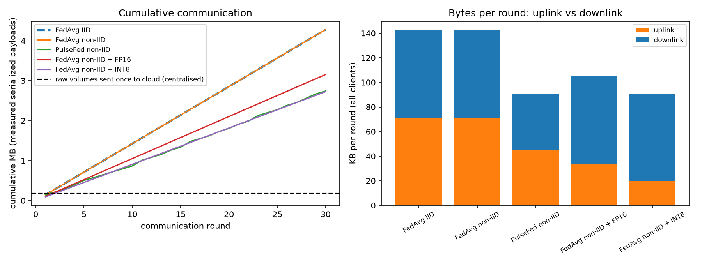
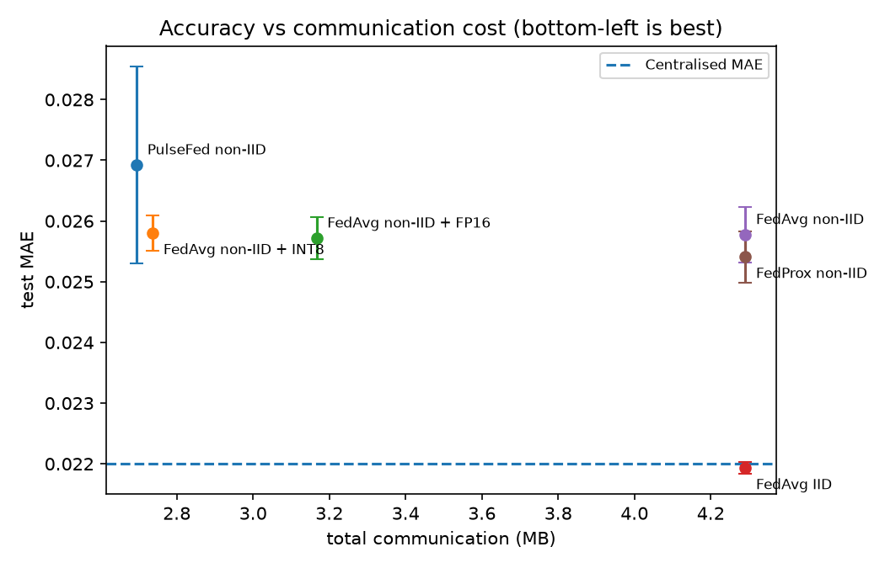
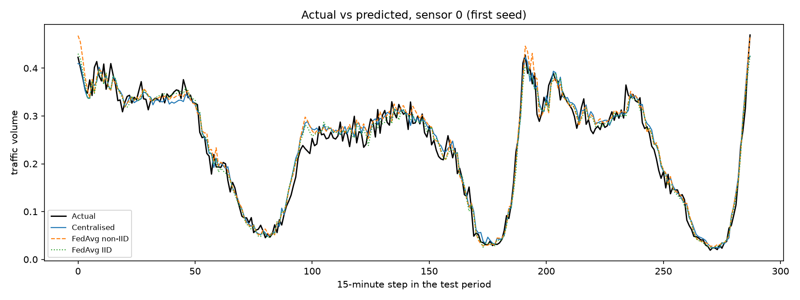
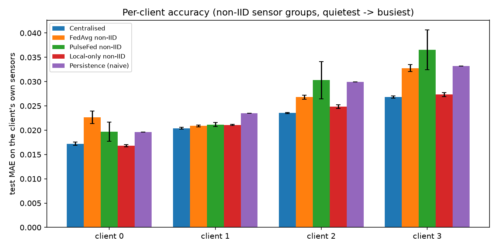
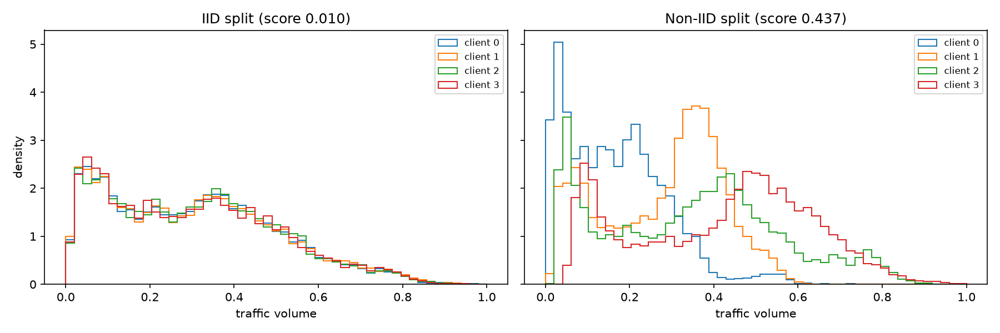
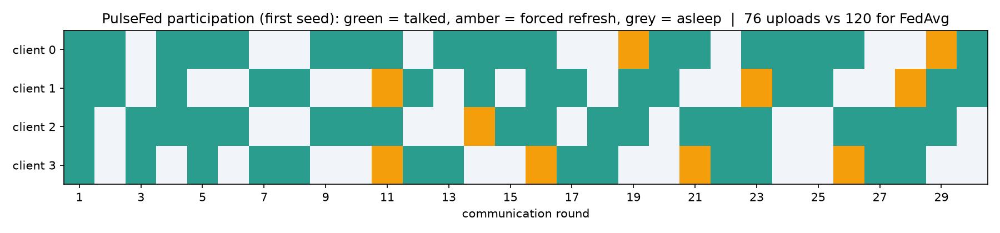

# PS-003 - Federated Traffic-Flow Prediction with Communication-Cost Evaluation
*Auto-generated by `step6_make_report.py` on 2026-10-30. All numbers are read from `results/`.*

## Status
All 9 experiments completed with 3 seeds.

## 1. Dataset
UCI Machine Learning Repository, *Traffic Flow Forecasting* (id 608, CC BY 4.0; Zhao, 2019, doi:10.24432/C57897; original paper: Zhao, Gkountouna & Pfoser, ACM TSAS 2019, doi:10.1145/3339823). Traffic volume every 15 minutes at 36 sensors on two highways in Northern Virginia / Washington D.C. Task: predict each sensor's volume 15 minutes ahead.

| Property | Value |
|---|---|
| Training time steps | 1261 |
| Test time steps (held out, later period) | 840 |
| Sensors | 36 |
| Raw features per sensor | 48 |
| Model input features | 30 |
| Missing values found (X_tr / Y_tr / X_te / Y_te) | 0 / 0 / 0 / 0 |
| Consecutive 15-min rows (train / test) | 100.0% / 100.0% |
| Test period starts one step after training ends | 100.0% of sensors |
| Provided target (`tra_Y`) | 2 step(s) = 30 min after the newest lag |
| Target used in this project | value 15 min after the newest reading (rebuilt from consecutive rows) |

**Data-integrity findings.** Our audit (`step2b_diagnose_layout.py`) found that the file differs from its documentation in three ways, and we handle each explicitly:
1. **48 columns, not 47:** 10 lags (oldest to newest), a 5-category day indicator (documented as 7 weekdays), 24 hour-of-day columns, number of lanes, 4 direction columns and a 4-column one-hot road name.
2. **Target horizon:** the provided target is 2 steps (30 min) after the newest lag in the same row. Because every row's lag window is the previous window shifted by one step, the true next-15-minute value can be read from the next row; we use that as our target (set `TARGET_MODE = "dataset"` in `src/config.py` to use the provided target instead).
3. **Time order:** the documentation's dates suggest the test period lies before the training period, but the lag windows show the training rows are consecutive and the first test row follows the last training row directly. The provided split is therefore a valid chronological split (train earlier, test later).

## 2. Methodology
- **Features:** the 10 most recent volumes, their mean, standard deviation, last change and 10-step trend, hour of day (sine/cosine), the day indicator, road direction and road name (one-hot) and number of lanes. Volumes are already scaled to 0-1 in the file, so errors are in those units.
- **Split:** the dataset's training period is used for training and the later test period for evaluation only. Standardisation statistics come from training data only.
- **Federated standardisation:** each client sends only its row count, feature sums and sums of squares; the server combines them into the same mean/std a pooled scaler would compute (verified by a unit test). These bytes are included in the communication cost.
- **Clients:** 4 simulated intersections. *IID*: all training rows shuffled and dealt evenly. *Non-IID*: each sensor belongs to one client; sensors sorted by mean training volume and cut into contiguous groups (quietest to busiest roads).
- **Model:** identical MLP everywhere (64-32 hidden units, ReLU, NumPy implementation), MSE loss, Adam (lr 0.001), batch 64.
- **FedAvg:** 30 rounds x 1 local epoch(s); aggregation weighted by client sample counts. Centralised training uses the same total number of epochs.
- **Communication cost:** length of the real serialized byte payloads (`numpy.savez`); downlink counts one copy per client.
- **Evaluation:** MAE and RMSE in original volume units on the same test period for every method; final model after a fixed budget (the test set is never used for tuning).
- **Seeds:** [0, 1, 2]; mean ± sample standard deviation reported.

## 3. Prediction accuracy (test period)
| Method | MAE | RMSE | Seeds | Beyond PS-003 minimum |
|---|---|---|---|---|
| Persistence baseline (next = current) | 0.0266 ± 0.0000 | 0.0388 ± 0.0000 | 3 | yes |
| Centralised MLP | 0.0220 ± 0.0001 | 0.0322 ± 0.0002 | 3 |  |
| FedAvg, IID clients | 0.0219 ± 0.0001 | 0.0321 ± 0.0001 | 3 |  |
| FedAvg, non-IID clients | 0.0258 ± 0.0005 | 0.0371 ± 0.0005 | 3 |  |
| Local-only (no collaboration), non-IID | 0.0225 ± 0.0001 | 0.0328 ± 0.0002 | 3 | yes |
| PulseFed (update-aware participation), non-IID | 0.0269 ± 0.0016 | 0.0406 ± 0.0038 | 3 | yes |
| FedProx (mu=0.01), non-IID | 0.0254 ± 0.0004 | 0.0366 ± 0.0005 | 3 | yes |
| FedAvg non-IID + FP16 uplink | 0.0257 ± 0.0004 | 0.0370 ± 0.0001 | 3 | yes |
| FedAvg non-IID + INT8 uplink | 0.0258 ± 0.0003 | 0.0371 ± 0.0002 | 3 | yes |

Per-seed values

| Method | Seed | MAE | RMSE |
|---|---|---|---|
| persistence | 0 | 0.0266 | 0.0388 |
| persistence | 1 | 0.0266 | 0.0388 |
| persistence | 2 | 0.0266 | 0.0388 |
| centralized | 0 | 0.0219 | 0.0320 |
| centralized | 1 | 0.0221 | 0.0322 |
| centralized | 2 | 0.0220 | 0.0324 |
| fedavg_iid | 0 | 0.0218 | 0.0320 |
| fedavg_iid | 1 | 0.0220 | 0.0322 |
| fedavg_iid | 2 | 0.0219 | 0.0321 |
| fedavg_noniid | 0 | 0.0253 | 0.0366 |
| fedavg_noniid | 1 | 0.0258 | 0.0375 |
| fedavg_noniid | 2 | 0.0262 | 0.0373 |
| local_only_noniid | 0 | 0.0224 | 0.0327 |
| local_only_noniid | 1 | 0.0227 | 0.0330 |
| local_only_noniid | 2 | 0.0225 | 0.0327 |
| pulsefed_noniid | 0 | 0.0272 | 0.0427 |
| pulsefed_noniid | 1 | 0.0284 | 0.0429 |
| pulsefed_noniid | 2 | 0.0252 | 0.0362 |
| fedprox_noniid | 0 | 0.0249 | 0.0360 |
| fedprox_noniid | 1 | 0.0255 | 0.0370 |
| fedprox_noniid | 2 | 0.0257 | 0.0368 |
| fedavg_noniid_fp16 | 0 | 0.0255 | 0.0369 |
| fedavg_noniid_fp16 | 1 | 0.0255 | 0.0370 |
| fedavg_noniid_fp16 | 2 | 0.0261 | 0.0371 |
| fedavg_noniid_int8 | 0 | 0.0256 | 0.0368 |
| fedavg_noniid_int8 | 1 | 0.0257 | 0.0370 |
| fedavg_noniid_int8 | 2 | 0.0261 | 0.0373 |

**Gap to centralised (MAE):**
- FedAvg, IID clients: -0.3%
- FedAvg, non-IID clients: +17.2%
- PulseFed (update-aware participation), non-IID: +22.4%
- FedProx (mu=0.01), non-IID: +15.5%
- Local-only (no collaboration), non-IID: +2.3%
- Persistence baseline (next = current): +20.8%

## 4. Communication cost
| Method | Bytes per round (mean) | Total incl. setup | MAE |
|---|---|---|---|
| FedAvg, IID clients | 142.6 KB | 4.291 MB | 0.0219 ± 0.0001 |
| FedAvg, non-IID clients | 142.6 KB | 4.291 MB | 0.0258 ± 0.0005 |
| PulseFed (update-aware participation), non-IID | 91.4 KB | 2.755 MB | 0.0269 ± 0.0016 |
| FedProx (mu=0.01), non-IID | 142.6 KB | 4.291 MB | 0.0254 ± 0.0004 |
| FedAvg non-IID + FP16 uplink | 105.1 KB | 3.167 MB | 0.0257 ± 0.0004 |
| FedAvg non-IID + INT8 uplink | 90.8 KB | 2.737 MB | 0.0258 ± 0.0003 |

- Model size: 4,097 parameters = 16.4 KB as float32; one serialized payload adds format overhead (measured downlink per client: 17.8 KB).
- Uploading the raw training volumes once (float32, one value per sensor per step) would cost 0.182 MB; full feature rows cost 5.630 MB.
- **Break-even:** one full FedAvg training (4.291 MB) costs as much as streaming raw volumes from 36 sensors for 310.4 days. FedAvg cost depends on model size x rounds, while raw streaming grows with time and number of sensors, so FL saves bandwidth only for long deployments, many sensors, or richer raw data (e.g. video). This is a computed estimate from measured payload sizes.

## 5. Convergence
Rounds needed to reach within 5% of centralised MAE (target MAE 0.0231):

| Method | Rounds to target (per seed) | Final-round MAE |
|---|---|---|
| FedAvg, IID clients | 8, 7, 7 | 0.0219 ± 0.0001 |
| FedAvg, non-IID clients | not reached, not reached, not reached | 0.0258 ± 0.0005 |
| PulseFed (update-aware participation), non-IID | not reached, not reached, not reached | 0.0269 ± 0.0016 |
| FedProx (mu=0.01), non-IID | not reached, not reached, not reached | 0.0254 ± 0.0004 |
| FedAvg non-IID + FP16 uplink | not reached, not reached, not reached | 0.0257 ± 0.0004 |
| FedAvg non-IID + INT8 uplink | not reached, not reached, not reached | 0.0258 ± 0.0003 |

See `figures/02_convergence_iid_vs_noniid.png`.

## 6. PulseFed participation
- Rule: clients at or above the average update size talk; at least 2 talk every round; no client sleeps more than 2 rounds in a row; round 1 includes everyone.
- Uploads per run: 76, 72, 75 (per seed) vs 120 for FedAvg.
- Total bytes (incl. control messages): 63% of FedAvg non-IID.
- MAE change vs FedAvg non-IID: +0.0011.
- See `figures/08_pulsefed_participation.png` and the per-client table below (does PulseFed silence quiet roads?).

## 7. Data heterogeneity and per-client results
Heterogeneity score = Wasserstein distance between a client's target distribution and the global one, divided by the global standard deviation (0 = identical).

| Client | IID rows | IID score | Non-IID rows | Non-IID mean volume | Non-IID score |
|---|---|---|---|---|---|
| 0 | 11,349 | 0.006 | 11,349 | 0.166 | 0.689 |
| 1 | 11,349 | 0.007 | 11,349 | 0.282 | 0.254 |
| 2 | 11,349 | 0.012 | 11,349 | 0.348 | 0.223 |
| 3 | 11,349 | 0.014 | 11,349 | 0.420 | 0.580 |
| **mean** | | **0.010** | | | **0.437** |

Test MAE on each non-IID client's own sensors (mean over seeds):

| Method | Client 0 | Client 1 | Client 2 | Client 3 |
|---|---|---|---|---|
| Centralised MLP | 0.0172 | 0.0204 | 0.0235 | 0.0268 |
| FedAvg, non-IID clients | 0.0226 | 0.0209 | 0.0268 | 0.0328 |
| PulseFed (update-aware participation), non-IID | 0.0197 | 0.0212 | 0.0303 | 0.0365 |
| Local-only (no collaboration), non-IID | 0.0168 | 0.0211 | 0.0248 | 0.0273 |

## 8. Figures
**Raw traffic, quietest vs busiest sensor**

**MAE / RMSE of all methods**

**Test error per round, IID vs non-IID**

**Cumulative and per-round bytes**

**Accuracy vs communication trade-off**

**Actual vs predicted traffic**

**Per-client accuracy**

**Client data distributions**

**PulseFed: who talked in which round**

## 9. Limitations
- Simulation on one machine: no real network latency, packet loss or client drop-out.
- One dataset (36 sensors, about 3 weeks); results may not transfer to other cities.
- Partial participation is studied only through PulseFed; random client sampling and client drop-out are not.
- No formal privacy guarantee (no differential privacy or secure aggregation), as allowed by PS-003. Model updates can still leak information.
- Fixed hyper-parameters, not tuned per method; a validation-based tuning could change the gaps.
- Payload sizes include `.npz` container overhead (compare measured payload vs float32 model size in Section 4); a custom binary format would be smaller.

## 10. Conclusions
*Automatic factual summary (the team should add its own interpretation below):*

- Lowest mean test MAE: **FedAvg, IID clients** (0.0219).
- The centralised MLP beats the persistence baseline.
- Non-IID FedAvg MAE minus IID FedAvg MAE: +0.0038.
- Collaboration via FedAvg is NOT better than local-only training.
- PulseFed uses 63% of plain FedAvg's total bytes with an MAE change of +0.0011.
- INT8 uplink uses 64% of plain FedAvg's total bytes with an MAE change of +0.0000.

### Team interpretation

1. **Federated learning matches centralised training when junctions are similar.** FedAvg on IID clients reached MAE 0.0219 versus 0.0220 for the centralised model, and came within 5% of centralised accuracy after only 7–8 rounds, without any raw data leaving the clients.

2. **Heterogeneity is the real cost, and it falls on the extremes.** With sensors grouped from quietest to busiest road (heterogeneity 0.437 vs 0.010 for IID), FedAvg was 17% worse than centralised and never reached the 5% target within 30 rounds. The per-client view shows where the damage lands: on the quietest roads (client 0) FedAvg was 31% worse than centralised and even worse than the naive persistence baseline (0.0226 vs 0.0196); on the busiest roads (client 3) it was 22% worse; client 1 was almost unaffected (about +2%). One averaged model fits the "average road" and neither extreme.

3. **Local models beat the shared model here.** Training each road group on its own data (MAE 0.0225) outperformed non-IID FedAvg (0.0258). Personalised federated learning, for example fine-tuning the global model locally, is the most promising next step.

4. **FedProx (μ = 0.01) gave no clear improvement** (0.0254 vs 0.0258; the gap is within seed-to-seed variation).

5. **Compression is a free win.** Sending INT8-quantised updates cut total traffic by 36% (4.29 → 2.74 MB) with no measurable accuracy loss; FP16 cut it by 26%.

6. **PulseFed, our proposed heuristic, did not pay off on this dataset.** It cut traffic by 37% but raised the error (MAE +4%, RMSE +9% versus FedAvg non-IID) and made results unstable across seeds. The equity view explains why: in the participation chart the busiest road group was repeatedly put to sleep and needed forced refreshes, and its error rose to 0.0365, worse than the persistence baseline (0.0332). INT8 achieves almost the same saving without this cost, so we recommend INT8 over PulseFed here. The overall MAE alone would have hidden this failure; the per-client check exposed it.

7. **Bandwidth: measure before you federate.** One FedAvg training run sends 4.29 MB, about 24 times the raw volume counts (0.18 MB) and equal to roughly 310 days of streaming raw counts from all 36 sensors. It is, however, less than uploading the full feature rows (5.63 MB). For scalar loop detectors, the value of federated learning lies in keeping data local rather than saving bandwidth; for data-heavy sensors such as cameras, the balance reverses.
